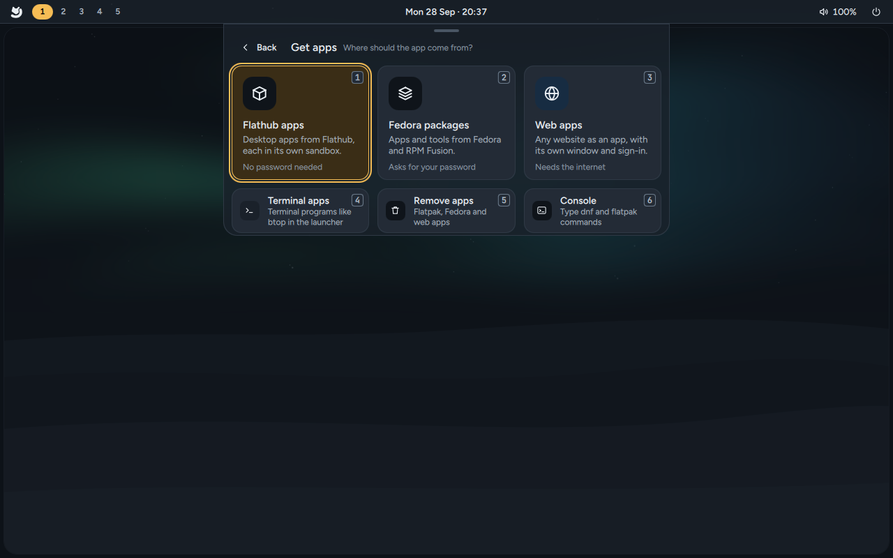
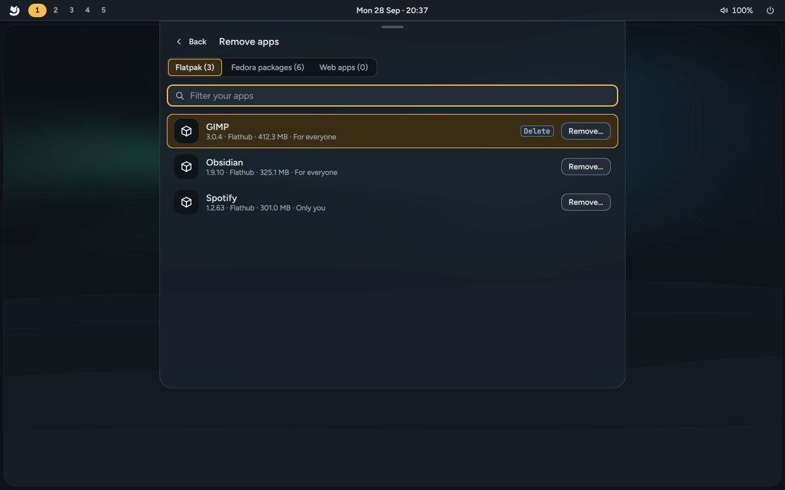

# Apps and software

Arctic Linux starts with the apps you pick in the installer, from a catalog of 132. Afterwards
you can add almost anything from three places: Fedora's own packages (dnf), Flathub (Flatpak) and
Nix. **Get apps** (`Super + Shift + A`) installs software; the launcher has a separate
**Remove apps** menu for uninstalling it.

## The default apps

New installations select these native apps. You can choose alternatives or untick optional
roles in the installer. Existing accounts keep their chosen defaults and installed apps when
Arctic packages update.

| Role | Default | Opens with | Comes from |
|---|---|---|---|
| Browser | **GNOME Web (Epiphany)** | `Super + B` | Fedora |
| Text editor | **FeatherPad** | `Super + E` | Fedora |
| Terminal | **Foot** | `Super + Enter` | Fedora |
| Shell | **Fish**, with Bash also available | inside the terminal | Fedora |
| File manager | **PCManFM**, Fedora's GTK3 build | `Super + F` | Fedora |
| Archives | **XArchiver**, included with PCManFM | opening an archive | Fedora |
| Video and audio | **Celluloid**, built on mpv | opening a media file | Fedora |
| Recovery text editor | **Nano** | `nano` in a terminal | Fedora |

Office suites, code editors and the terminal file manager **yazi** are optional. The selected
browser opens web links, FeatherPad opens text/source files, PCManFM opens folders, XArchiver
opens supported archives, and Celluloid opens supported audio/video files. **Settings → Default
apps** changes these choices later. Bash and Nano remain available as system tools.

The image writes these associations through the standard `mimeapps.list` mechanism. They cover
HTTP/HTTPS and HTML, common plain-text and source formats, folders, common audio/video formats and
ZIP, tar, 7-Zip, gzip, bzip2, xz, zstd and cpio archives. An app selected in the installer or later
in **Default apps** replaces the relevant association for that account.

## Everything the installer offers

The installer's app picker has **132 apps in 21 sections**. The first seven sections (browser,
editor, terminal, shell, file manager, office and video) are always open, with the defaults
ticked. The other fourteen sit under **More apps**: they start folded, and nothing in them is
ticked until you pick it. Open a section, or type in the search box to look through
every app by name, description or section (try *music*, *PDF* or *games*).

- **Pick one** sections (browser, terminal, shell) need exactly one app; it becomes your default.
  Office is **pick one or none**. Every other section is **pick any**.
- Apps marked **Proprietary** aren't open source.
- A few apps need another one: **Podman Desktop** needs **Podman**, and **lazygit** needs
  **Git**. The installer tells you on Next if one is missing.
- When an app has more than one source, the installer tries them in the order shown and uses the
  first that works. Apps that come from Flathub bring a shared runtime the first time, which the
  download estimate at the bottom of the picker includes.

In the tables, **Fedora** means Fedora 44's own packages, **RPM Fusion** the RPM Fusion
repositories (which the installer always adds), **Flathub** a Flatpak app, **COPR** a community
package repository, and **Nix** the Nix package manager.

### Browser

| App | What it is | Comes from |
|---|---|---|
| **GNOME Web (Epiphany)** (ticked) | Simple browser with a sandboxed WebKit web process. | Fedora |
| Zen Browser | Calm, privacy-first browser with vertical tabs. | Flathub |
| Firefox | The classic open-source browser. | Fedora, else Flathub |
| Brave | Blocks ads and trackers out of the box. | Flathub |
| Google Chrome · *Proprietary* | Google's browser, synced to your account. | Flathub |
| LibreWolf | Firefox tuned for privacy, with no telemetry. | Flathub |
| Chromium | Open-source base of Chrome. | Fedora, else Flathub |
| Vivaldi · *Proprietary* | Feature-packed browser you can reshape. | Flathub |

### Editor

| App | What it is | Comes from |
|---|---|---|
| **FeatherPad** (ticked) | Lightweight text editor with tabs, search and highlighting. | Fedora |
| Zed | Fast, modern code editor. | Flathub |
| Visual Studio Code · *Proprietary* | Microsoft's popular code editor. | Flathub |
| VSCodium | VS Code without the telemetry. | Flathub |
| Neovim | Keyboard-driven text editor for the terminal. | Fedora |
| Helix | Modal editor that works out of the box. | Fedora |
| Kate | KDE's capable text and code editor. | Fedora, else Flathub |
| Emacs | The endlessly extensible editor. | Fedora, else Flathub |
| Text Editor | Simple notepad for everyday text. | Fedora, else Flathub |

### Terminal

| App | What it is | Comes from |
|---|---|---|
| kitty | Fast, GPU-drawn terminal. | Fedora |
| Ghostty | Fast, native terminal with sensible defaults. | COPR `scottames/ghostty` |
| Alacritty | Minimal GPU terminal. | Fedora |
| **Foot** (ticked) | Lightweight Wayland terminal. | Fedora |
| Konsole | KDE's terminal with tabs, splits and profiles. | Fedora |

### Shell

| App | What it is | Comes from |
|---|---|---|
| zsh | Friendly shell with smart completion. | Fedora |
| **fish** (ticked) | Shell with suggestions as you type. | Fedora |
| bash | The standard Linux shell. | Fedora |

### File manager

| App | What it is | Comes from |
|---|---|---|
| **PCManFM** (ticked) | GTK3 file manager, with XArchiver and archive helpers. | Fedora |
| yazi | Quick file manager inside the terminal. | COPR `lihaohong/yazi`, else Nix |
| Thunar | Simple windowed file manager. | Fedora |
| Files (Nautilus) | GNOME's file manager. | Fedora |
| Dolphin | KDE's file manager with tabs and split view. | Fedora |
| Nemo | Familiar, full-featured file manager. | Fedora |
| PCManFM-Qt | Very light windowed file manager. | Fedora |

### Office

No office suite is ticked by default. Choose one if you need it.

| App | What it is | Comes from |
|---|---|---|
| Collabora Office | Documents, spreadsheets and slides. | Flathub |
| LibreOffice | The full classic office suite. | Flathub, else Fedora |
| ONLYOFFICE | Office suite close to Microsoft formats. | Flathub |

### Video

| App | What it is | Comes from |
|---|---|---|
| VLC | Plays almost any video or audio file. | Fedora, with RPM Fusion's codec plugins |
| mpv | Minimal, keyboard-driven player. | Fedora, else Flathub |
| **Celluloid** (ticked) | Simple player built on mpv. | Fedora, else Flathub |
| Haruna | Feature-rich player built on mpv. | Fedora, else Flathub |
| Kodi | Media centre for your TV, films and music. | RPM Fusion, else Flathub |
| Jellyfin Media Player | Watch your Jellyfin server's library. | Flathub |

### More apps

These start folded in the picker, and nothing here is ticked by default.

#### Music & audio

| App | What it is | Comes from |
|---|---|---|
| Spotify · *Proprietary* | Stream music and podcasts. | Flathub |
| Strawberry | Music player for big local collections. | Fedora, else Flathub |
| Tauon | Stylish player for your music library. | Flathub |
| Amberol | Plays music, and nothing else. | Flathub |
| Rhythmbox | Classic music library and radio player. | Fedora, else Flathub |
| Shortwave | Listen to internet radio stations. | Flathub |
| Easy Effects | Equaliser and effects for all your sound. | Flathub, else Fedora |

#### Photos

| App | What it is | Comes from |
|---|---|---|
| Image Viewer (Loupe) | Fast, simple image viewer. | Fedora, else Flathub |
| gThumb | Browse, view and touch up photos. | Fedora, else Flathub |
| Shotwell | Import and organise your photos. | Fedora, else Flathub |
| digiKam | Professional photo management. | Flathub |
| darktable | Develop RAW photos like a darkroom. | Fedora, else Flathub |
| RawTherapee | Detailed RAW photo processing. | Fedora, else Flathub |

#### Graphics & design

| App | What it is | Comes from |
|---|---|---|
| GIMP | Photo editing and painting. | Fedora, else Flathub |
| Krita | Digital painting for artists. | Flathub, else Fedora |
| Inkscape | Vector drawing. | Fedora, else Flathub |
| Blender | 3D modelling, animation and rendering. | Flathub |
| Pinta | Easy drawing and image editing. | Flathub |
| FreeCAD | 3D design for real-world objects. | Flathub |

#### Recording & editing

| App | What it is | Comes from |
|---|---|---|
| OBS Studio | Screen recording and streaming. | Flathub |
| GPU Screen Recorder | Record gameplay with almost no slowdown. | Flathub |
| Kooha | Record your screen in one click. | Flathub |
| Audacity | Record and edit audio. | Fedora, else Flathub |
| Kdenlive | Full-featured video editor. | Flathub, else Fedora |
| Shotcut | Straightforward video editor. | Fedora, else Flathub |
| HandBrake | Convert videos to other formats. | RPM Fusion, else Flathub |

#### Chat & calls

| App | What it is | Comes from |
|---|---|---|
| Signal | Private messaging. | Flathub |
| Discord · *Proprietary* | Voice, video and text chat for communities. | Flathub |
| Telegram | Fast messaging that syncs everywhere. | RPM Fusion, else Flathub |
| Element | Secure chat on the Matrix network. | Flathub |
| Slack · *Proprietary* | Team chat for work. | Flathub |
| Zoom · *Proprietary* | Video meetings and calls. | Flathub |
| ZapZap | WhatsApp in its own window (unofficial). | Flathub |

#### Email & calendar

| App | What it is | Comes from |
|---|---|---|
| Thunderbird | Email, calendar and contacts in one. | Flathub, else Fedora |
| Evolution | Email and calendar, with Exchange support. | Fedora, else Flathub |
| Betterbird | Thunderbird with extra fixes and features. | Flathub |

#### Notes & tasks

| App | What it is | Comes from |
|---|---|---|
| Obsidian · *Proprietary* | Markdown notes, linked like a second brain. | Flathub |
| Joplin | Notes and to-dos that sync anywhere. | Flathub |
| Logseq | Outliner for daily notes and ideas. | Flathub |
| AppFlowy | Docs, wikis and boards, like Notion. | Flathub |
| Standard Notes | Simple notes, end-to-end encrypted. | Flathub |
| Xournal++ | Handwritten notes and PDF annotation. | Flathub, else Fedora |
| Planify | To-do lists and task planning. | Flathub |

#### PDF & e-books

| App | What it is | Comes from |
|---|---|---|
| Papers | Clean, simple PDF reader. | Fedora, else Flathub |
| Okular | Reads PDFs, e-books and comics, with notes. | Flathub, else Fedora |
| Zathura | Minimal, keyboard-driven PDF reader. | Fedora, else Flathub |
| Foliate | Comfortable e-book reader. | Fedora, else Flathub |
| calibre | Organise and convert your e-book library. | Fedora, else Flathub |
| PDF Arranger | Merge, split and reorder PDF pages. | Fedora, else Flathub |

#### Games

| App | What it is | Comes from |
|---|---|---|
| Steam · *Proprietary* | Games and the Steam store. | RPM Fusion, else Flathub |
| Heroic | Plays your Epic, GOG and Amazon games. | Flathub |
| Lutris | One library for games from everywhere. | Flathub, else Fedora |
| Bottles | Run Windows apps and games. | Flathub |
| Prism Launcher | Manage Minecraft versions and mods. | Flathub |
| ProtonPlus | Adds newer Proton versions for Windows games. | Flathub |
| MangoHud | On-screen FPS and hardware stats in games. | Fedora |
| GameMode | Gives games full speed while they run. | Fedora |

#### Passwords & privacy

| App | What it is | Comes from |
|---|---|---|
| KeePassXC | Offline password manager you control. | Fedora, else Flathub |
| Bitwarden | Open-source password manager with sync. | Flathub |
| 1Password · *Proprietary* | Password manager for families and teams. | Flathub |
| Proton Pass | Encrypted passwords from Proton. | Flathub |
| Authenticator | Two-factor codes for your accounts. | Flathub |
| Proton VPN | Free, no-logs VPN from Proton. | Flathub |
| Tor Browser | Browser with its own Tor connection. | Flathub |
| Tor SOCKS client | Optional per-app SOCKS connection; starts only when requested. | Fedora |
| Tailscale | Private network between your devices; sign-in and routing are separate choices. | Fedora |
| OpenVPN support | NetworkManager plugin for importing a provider profile. | Fedora |

#### Downloads & sync

| App | What it is | Comes from |
|---|---|---|
| qBittorrent | Full-featured torrent downloader. | Fedora, else Flathub |
| Transmission | Simple, light torrent downloader. | Fedora, else Flathub |
| Syncthing | Syncs folders between your devices, privately. | Fedora |
| Nextcloud | Syncs files with your Nextcloud server. | Fedora, else Flathub |
| LocalSend | Send files to nearby phones and computers. | Flathub |

#### Developer tools

| App | What it is | Comes from |
|---|---|---|
| Git | Version control, with the GitHub command line. | Fedora |
| lazygit | Git in a friendly terminal interface. | Nix |
| Meld | Compare files and folders side by side. | Fedora, else Flathub |
| DBeaver | One tool for every database. | Flathub |
| Bruno | Test APIs, with collections kept in Git. | Flathub |

#### Containers & VMs

| App | What it is | Comes from |
|---|---|---|
| Podman | Run containers without a background daemon. | Fedora |
| Podman Desktop | Manage containers and images visually. | Flathub |
| Distrobox | Use other Linux distros inside containers. | Fedora |
| GNOME Boxes | Try other systems in virtual machines. | Fedora, else Flathub |
| Virtual Machine Manager | Advanced virtual machines with KVM. | Fedora |
| Waydroid | Android apps. Gets 1 GB on first run. | Fedora |

#### Utilities

| App | What it is | Comes from |
|---|---|---|
| Flathub | Adds the Flathub app store (Flatpak). | Flathub (adds the store only) |
| Bazaar | Browse and install apps from Flathub. | Flathub |
| Flatseal | Review what each Flatpak app may access. | Flathub, else Fedora |
| Mission Center | See what's using your CPU, memory and GPU. | Flathub |
| GNOME Disks | Format drives and write disk images. | Fedora |
| Pika Backup | Easy, encrypted backups of your files. | Flathub |
| File Roller | Open and create zip and other archives. | Fedora, else Flathub |
| Btrfs Assistant | Browse and restore system snapshots. | Fedora |

The **Flathub** entry only adds the Flathub app store, with no app. **Bazaar** is an app store
for Flathub apps. **Btrfs Assistant** shows the system snapshots Arctic Linux takes around every
update (see [Updates](Updates#undoing-an-update)).

## Drivers

When the installer finds hardware that works better with a driver from RPM Fusion, a **Drivers**
section comes first in the picker, with the driver already ticked for the card it found. There's
no Drivers section when nothing needs one.

| Driver | For | Packages |
|---|---|---|
| **NVIDIA driver** | NVIDIA GeForce RTX 20 series (Turing) and newer, including the NVIDIA card in hybrid laptops | `akmod-nvidia`, CUDA libraries, `libva-nvidia-driver` |
| **NVIDIA driver (580 series)** | NVIDIA GeForce GTX 750 to GTX 1080 Ti and Titan V (Maxwell, Pascal and Volta) | `akmod-nvidia-580xx` (the last series for these cards) |
| **Intel video acceleration** | Intel graphics from Broadwell (5th generation Core) on, and Arc | `intel-media-driver`, with H.264 and H.265 |
| **AMD video acceleration** | AMD Radeon graphics and APUs with a video decoder | `mesa-va-drivers-freeworld`, `mesa-vulkan-drivers-freeworld` |
| **Broadcom Wi-Fi driver** | Broadcom Wi-Fi chips that have no working open driver (BCM4311, BCM4312, BCM4321, BCM4322, BCM4331, BCM43142, BCM4352, BCM4360) | `akmod-wl`, `broadcom-wl` |

The NVIDIA and Broadcom drivers are built for your kernel on your computer (by akmods) and are
built again for every new kernel. With Secure Boot on, you confirm their key once after the
install; see [Install Arctic Linux](Install-Arctic-Linux#secure-boot-and-your-driver). Older
NVIDIA cards (Kepler and before) keep the open driver: their NVIDIA drivers don't work with Mango.
Everything about drivers, including adding one later, is on [Drivers](Drivers).

## Always added

Whatever you pick, the installer also adds:

- **Media codecs**: the RPM Fusion repositories (free and nonfree), full FFmpeg and OpenH264, so
  most video and audio formats play.
- **Flatpak** and **Nix**, ready to use, and the adw-gtk3 theme for Flatpak apps, so they follow the Arctic theme.
- **bash**, even if you picked another shell.

Your browser, office suite, video player and file manager become the defaults for opening web
links, documents, videos and folders.

## Get apps



**Get apps** installs software. Open it with `Super + Shift + A`, or choose **Get apps** in the
launcher (`Super + Space`). It first asks where the app should come from:

| Card | What it does |
|---|---|
| **Flathub apps** (`1`) | Desktop apps from Flathub, each in its own sandbox. No password needed. |
| **Fedora packages** (`2`) | Apps and tools from Fedora and RPM Fusion, with dnf. Asks for your password once. |
| **Web apps** (`3`) | Any website as an app, with its own window, icon and sign-in (see [Web apps](Web-Apps)). Shown when the web-app engine is installed. |
| **Nix packages** (`4`, installed systems) | Search Nixpkgs, manage your profile, update and roll back. |
| **Terminal apps** (`5`) | Puts a terminal program like `btop` in the launcher, in a floating or tiled window. |
| **Console** (`6`) | Type `dnf` and `flatpak` commands. |

The digits follow the visible cards: Nix is hidden in the live session, and Web apps is hidden
when its engine is unavailable. Press a card's digit, or move with the arrow keys and press `Enter`. `Esc` goes back one step
(it closes an open panel, then clears what you typed, then returns to this chooser, then to the
launcher).

**Flathub apps** lists Flathub's catalogue with names, summaries, icons and the **Verified**
badge for apps their developers publish themselves. Type to search, `Enter` installs the selected
app (or opens it when it's already installed), `Shift + Enter` shows its details. Apps install for
everyone on the computer without a password; if Flathub isn't set up yet, **Add Flathub** adds it
(that asks for your password once).

**Fedora packages** has two views: **Apps** (Fedora's app catalogue, `appstream-data`, with names
and icons) and **All packages** (every package, with its summary and repository: Fedora, RPM
Fusion, COPR or Arctic Linux). `Ctrl + Tab` switches between them. Installing asks for your
password once, in the desktop's password dialog; it's remembered for a few minutes.

Installs keep going when you close the launcher: the strip at the bottom of Get apps shows
progress (**Show details** shows dnf's or Flatpak's own output, **Stop** stops it), and a
notification says when an app is ready if Get apps isn't open. A second install waits for the
first.

**Terminal apps**: give a command (`btop`, `yazi`, `htop -t`) and a name; it gets a launcher entry
that opens in your terminal. If the program isn't installed, the page offers to find it in Fedora
packages. Remove the entry again in Remove apps; the program itself stays.

**Console**: a small terminal for `dnf` and `flatpak`, for when you know the command.

| Type | Does |
|---|---|
| `htop` | Installs `htop` from Fedora (`pkexec dnf5 install -y htop`). You can list several names. |
| `flathub:org.gimp.GIMP` | Installs an app from Flathub (`flatpak install -y flathub org.gimp.GIMP`) |
| `dnf search editor` | Searches Fedora's packages. `dnf info`, `dnf list` and other questions run without a password. |
| `dnf install …`, `dnf upgrade` | Runs as `pkexec dnf5 … -y` |
| `dnf remove …` (and `rm`, `autoremove`, `swap`, `distro-sync`, `--allowerasing` …) | First works out what would go, without a password, and stops if that includes a package Arctic Linux needs, your login shell or your only terminal. Then runs as `pkexec dnf5 …`: dnf lists everything that goes and asks `[y/N]` in the console |
| `flatpak install flathub …`, `flatpak update` | Runs as typed, with `-y` added; `flatpak uninstall` asks first |

- `Tab` completes package names; **Refresh list** updates the list of names now (it refreshes
  itself once a day).
- Packages Arctic Linux needs can't be removed here (see below).
- If a command asks for something (a `sudo` you typed, dnf's `[y/N]`), answer on the input line.
  A password is hidden as you type and never saved or logged.
- `Ctrl + C` (or **Stop**) stops the running command. **Clear** empties the console.
- A Flatpak app installed here gets its Arctic colours straight away (Zed, for example).

The installer's messages mention "the Software app": that's Get apps.

## Remove apps



**Remove apps** is a separate item in the launcher, also available from **Settings → Default
apps**. It is separate from Get apps' installation chooser. It has a tab per source: **Flatpak**, **Fedora packages**,
**Web apps** and **Terminal apps**. Pick an app and press **Remove…** (or `Delete`/`Enter`);
`Ctrl + Tab` moves between the tabs.

Nothing is removed before you confirm, and the confirmation says exactly what goes:

- **Fedora packages**: every package dnf would remove: the app, the packages that need it, and
  the ones nothing needs any more (untick **Also remove packages nothing else needs** to keep
  those). Removing asks for your password. When snapshots are set up, one is taken first, so the
  change can be undone (see [Undoing an update](Updates#undoing-an-update)).
- **Flatpak**: the app goes for everyone (or only for you, if you installed it that way). Its
  settings and data in `~/.var/app` stay unless you tick **Also delete its settings and data**.
  Runtimes no other app uses go too.
- **Web apps**: the app leaves the launcher; its sign-in stays unless you tick **Also sign out and
  delete its data**. Kept sign-in data is listed under **Saved sign-in data**, where you can delete
  it later.

You can also remove an app from the launcher: select it and press `Shift + Delete` (or `Delete`
when the text cursor is at the end), or right-click it.

Some packages can't be removed from here, and the page says why:

- **Part of Arctic Linux**: the desktop itself, the session, the package manager, the boot
  loader and the other packages listed in `/usr/share/arctic/shell/scripts/protected-packages.conf`,
  and everything the Arctic desktop needs (the session, its helpers and required dependencies). A removal that
  would take one of them along is refused as a whole.
- **Your login shell**: choose another shell first.
- **Your only terminal**: `Super + Enter` would stop working; install another terminal first.

Administrators can protect more packages with `fnmatch` patterns, one per line, in
`/etc/arctic/protected-packages.d/*.conf`. `sudo dnf remove` in a terminal isn't limited by this.

Remove apps isn't offered while you're trying Arctic Linux from the USB stick.

## dnf: Fedora's packages

Arctic Linux uses Fedora 44's package repositories, and the installer adds RPM Fusion. From a
terminal:

```sh
dnf search thunderbird            # find a package
sudo dnf install thunderbird      # install it
sudo dnf remove thunderbird       # remove it (or use Remove apps)
sudo dnf upgrade                  # update everything installed with dnf
```

## Flatpak and Flathub

Flathub has many desktop apps, each running in its own sandbox. If you installed any Flatpak app
in the installer (optional choices include Zen, Zed and Collabora Office) or ticked **Flathub**, the
Flathub remote is already set up. If it isn't, add it once:

```sh
flatpak remote-add --if-not-exists flathub https://dl.flathub.org/repo/flathub.flatpakrepo
```

Then:

```sh
flatpak search spotify
flatpak install flathub com.spotify.Client
flatpak update                    # update every Flatpak app
flatpak list                      # what's installed (Remove apps lists them too)
```

Installed Flatpak apps appear in the launcher.

## Nix

On an installed system, **Get apps → Nix packages** searches Nixpkgs and shows the packages in
your own Arctic profile. **Update** refreshes its packages; **Roll back…** switches to its previous
generation. These actions keep app data and do not roll back the operating system. Pinned inputs
remain pinned. Nix is updated with Arctic's system packages. Shared or external profiles must be
managed by their owner.

The Nix package manager comes preinstalled, with its background service running and the SELinux
settings it needs (Arctic's `arctic-selinux` package). It's handy for command-line tools that
aren't in Fedora, or for newer versions. For graphical apps, use Flatpak: apps from Nix often
can't use the graphics card on Fedora without extra setup.

Nix's newer commands are switched off by default, so pass the option each time:

```sh
nix --extra-experimental-features 'nix-command flakes' run nixpkgs#cowsay -- hello
nix --extra-experimental-features 'nix-command flakes' profile add nixpkgs#ripgrep
```

or turn them on once for your account:

```sh
mkdir -p ~/.config/nix
echo 'experimental-features = nix-command flakes' >> ~/.config/nix/nix.conf
nix profile add nixpkgs#ripgrep
```

Open a new terminal afterwards so the new commands are found.

## Updates

Everything installed with dnf (the system, Arctic's own packages, apps from Fedora and RPM
Fusion) updates by itself: downloaded in the background every day and installed the next time
the computer starts. Arctic's own packages come from its signed package repository. The
**Updates** page in Settings (`Super + S`) shows what's waiting and switches the channel; see
[Updates](Updates). Flatpak apps also update daily when automatic updates are on. You can update
Flatpak apps now and manage Nix profile updates yourself:

```sh
flatpak update        # Flatpak apps
nix profile upgrade --all    # Nix packages in your profile (with the options above)
```

## Changing which app opens

`Super + Enter`, `Super + B`, `Super + E`, `Super + F` and `Super + Shift + F` open the apps you
picked in the installer. To change them, and the apps that open links and files, open Settings
(`Super + S`) and choose **Default apps** (see [Settings](Settings#default-apps)). The files
behind it are on
[Themes and customisation](Themes-and-Customisation#default-apps).
