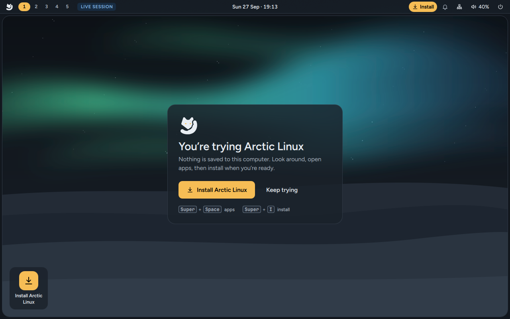

# Arctic Linux

Arctic Linux is a calm, keyboard-first desktop built on **Fedora 44** and the **Mango** tiling
window manager. Its look comes from the arctic fox: snow-white and blue-grey surfaces, rounded
corners, and one warm amber colour that shows you where you are.

One USB stick does everything. Start your computer from it to **try Arctic Linux** without
changing anything, then **install it** when you're ready. The installer asks one plain question
per screen, encrypts your disk by default, sets up the drivers your computer needs and only
downloads the apps you pick.

**[Watch the published showcase](Showcase)** — a narrated 1080p walkthrough. Its October 3
screens show earlier app choices; an updated English showcase is in preparation.

These pages describe the package sources now on `main`, which are available as signed updates
from the stable `arctic` repository. The latest published OS image is
[1.2.0](https://github.com/yuvalkolodkingal/Arctic-Linux/releases/tag/v1.2.0). The replacement ISO
is still being tested; it has no qualified download yet. Read the release page for the exact
contents and test results of the image you download.

## Start here

| You want to… | Read |
|---|---|
| Put Arctic Linux on a USB stick | [Download and create a USB](Download-and-Create-a-USB) |
| Look around without installing | [Try Arctic Linux](Try-Arctic-Linux) |
| Install it on your computer | [Install Arctic Linux](Install-Arctic-Linux) |
| Know what happens the first time it starts | [First boot](First-Boot) |
| Learn your way around the desktop | [Desktop tour](Desktop-Tour) and [Keyboard shortcuts](Keyboard-Shortcuts) |
| Change settings: displays, keyboard, windows, default apps | [Settings](Settings) |
| Warmer colours at night, or no sleep during a presentation | [Night light and keep awake](Night-Light-and-Keep-Awake) |
| Print or scan | [Printing and scanning](Printing-and-Scanning) |
| Use USB drives, phones, cameras and network shares | [Drives, phones and cameras](Drives-and-Phones) |
| Duplicate or extend your screen, or close the lid on a dock | [Screens and the laptop lid](Screens-and-Laptop-Lid) |
| Send files to your phone, or log in over SSH | [Sharing and phones](Sharing-and-Phones) |
| Add, remove or change apps | [Apps and software](Apps-and-Software) |
| Set up an NVIDIA, Intel, AMD or Broadcom driver | [Drivers](Drivers) |
| Keep it up to date, or undo an update | [Updates](Updates) |
| Change colours and wallpaper, or edit the settings files | [Themes and customisation](Themes-and-Customisation) |
| Type by speaking in Hebrew or English | [Local dictation](Local-Dictation) |
| Use the terminal | [Terminal and shell](Terminal-and-Shell) |
| Fix something that isn't working | [Troubleshooting](Troubleshooting) and [FAQ](FAQ) |

## What you get

- **Mango**, a tiling window manager for Wayland. Windows arrange themselves side by side with
  small gaps and rounded corners, and the window you're using has an amber border.
- **A desktop shell** made for Arctic Linux: the top bar, a launcher that also works as a
  calculator and a command runner, a wallpaper picker, **Get apps** and a separate **Remove apps** menu, volume and
  brightness pop-ups, a power menu and a lock screen.
- **Two built-in themes**, Winter (light) and Polar night (dark), plus **ten extra looks** and
  **colours from your wallpaper**: pick a picture of your own and the whole desktop, your apps
  included, takes its colours from it. `Super + Shift + T` switches between light and dark.
- **Arctic Settings** (`Super + S`): appearance, windows, displays, keyboard and mouse,
  shortcuts, default apps, network, Bluetooth, sound, updates, power and startup apps, in one
  place.
- **Foot and Fish** with the Arctic fox greeting, plus Bash and Nano.
- **132 apps in 21 installer sections**: the native defaults include GNOME Web, FeatherPad,
  Foot, PCManFM with XArchiver, Fish and Celluloid. Larger app choices stay optional.
  Flatpak and Nix are available.
- **Twenty-eight photo wallpapers**, including *Ember Clouds, City Silhouette*. Fresh defaults
  use *City Afterglow*; updates preserve existing users' wallpaper choices. Rotation can use the
  Arctic collection, your folder or **Both**. Packaged photos can be hidden per account and
  restored later without deleting RPM-owned files.
- **Local Hebrew/English dictation**, prepared during online installation or queued for offline
  first-boot recovery, with explicit recording, cancellation and visible readiness.
- **Drivers found for you:** NVIDIA, Intel and AMD video acceleration and Broadcom Wi-Fi, ticked
  in the installer when your computer has the hardware, with Secure Boot handled.
- **Automatic, signed updates**, installed when the computer restarts, with snapshots to go back.
- **Disk encryption on by default** (LUKS2), with the btrfs file system.

Everything has a keyboard shortcut, and everything also works with a mouse or touchpad.
Press `Super + /` on the desktop to see every shortcut.

## For developers

- [Building from source](Building-from-Source): the RPMs, the live ISO and the VM tests.
- [Architecture](Architecture): how the live session, the installer and the desktop fit together.
- [Design system](Design-System): colours, type, spacing and motion.
- [Contributing](Contributing): how to work on Arctic Linux.
- [Release notes](Release-Notes): what's in each version, what isn't yet, and upgrading from 0.1.

## About this wiki

These pages live in [`docs/wiki`](https://github.com/yuvalkolodkingal/Arctic-Linux/tree/main/docs/wiki)
in the repository and are published here by GitHub Actions, so a change to the docs goes through
the same review as a change to the code. Most screenshots were taken from Arctic Linux running
in a virtual machine or a headless test session, so small details may differ from what you see. The installer screenshots use its demo mode, so the disks, networks and names in them
are examples.
