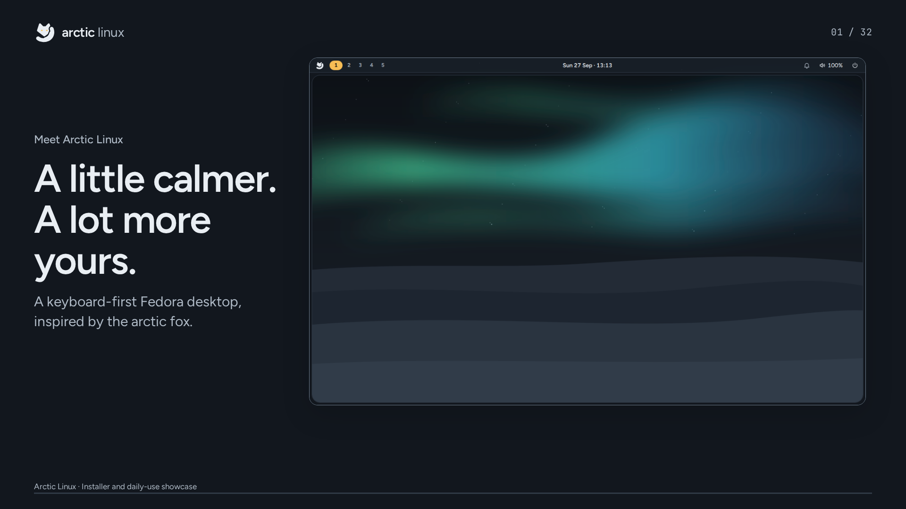

# Arctic Linux showcase

The published showcase is the 6 minute 47 second, 1920 × 1080 edition from 3 October 2026.
It uses Kokoro's `af_heart` narration and documents the earlier app set.

[Download the published video, captions, and editable source](https://github.com/yuvalkolodkingal/Arctic-Linux/releases/tag/showcase-2026-10-03).

[](https://github.com/yuvalkolodkingal/Arctic-Linux/releases/download/showcase-2026-10-03/Arctic-Linux-Showcase-1080p.mp4)

## River replacement source

The [current source and receipts](revision-2026-10-12/) describe the native app set, project
photo backgrounds, separate Remove apps, official VoxType 1.1.1 local dictation, signed stable updates,
the one-time What's New summary, and per-account hide/restore for packaged wallpapers.

The script has 38 scenes and 130 caption cues. Every time window is aligned to the verified
582.356463-second direct-VoxType 1.1.1 River master. Rendering remains blocked by human listening,
qualified final-image captures and release binding.

The prior faster-whisper results are preserved as evidence for the superseded master only. The
first full-script River request failed because the connector caps one request at 5,000 characters;
the locked script is 9,093 characters. That attempt has no renderable audio. The exact script is
now pinned as two minimum-count inputs of 4,451 and 4,642 characters, split between the Get apps
and Remove apps paragraphs. Both one-take River generations completed. Their verified sample-exact
assembly is 13,978,270 bytes and 582.356463 seconds, with SHA-256
`f6852132fed3f97e3b6a6b69fe4543e6af1a26c8495c9243e2cccfbde7c7081b`. The audio is preserved
outside Git and remains unpublished. Two offline faster-whisper 1.2.1 alignment runs produced
byte-identical outputs. The measured WER is 4.1412%, exact-token coverage is 97.4202%, and no cue
falls below half exact-token coverage. Human listening review remains pending.

The new source has **not** been rendered or published. Final-image captures for direct VoxType,
wallpaper management and What's New remain explicitly pending until the matching Arctic image
finishes qualification. The source composition keeps evidence cards in those five positions and
will replace them only with contract-validated, manually reviewed exact-image assets bound to the
same ISO receipt. Full decode, subtitle mux, representative-frame review, human listening,
release binding and public download verification must then run on the final render. The public
link above therefore continues to point to the 3 October edition.

## What the source shows

The app scenes cover GNOME Web, Foot, PCManFM, XArchiver, FeatherPad, Celluloid, Nano and
Fish/Bash. VoxType's official 1.1.1 daemon records, transcribes and inserts text directly. Arctic
downloads and verifies the signed upstream binary and multilingual model, supplies safe local
configuration, and presents sanitized readiness and error states. Online installation performs
that setup automatically. Offline installation reports that dictation is not ready and leaves a
clear first-boot retry. Mango's readiness helper starts the official service on first use and
invokes `voxtype record toggle`; Arctic's indicator follows VoxType's runtime state. The script
reports hosted Westmere CPU measurements of 7.77% English WER and 42.0%
Hebrew WER; processing took 15.79 and 11.63 times the respective audio durations. Evidence cards
remain until those paths are captured from the qualified ISO.
Those are the earlier values spoken by the locked River master. Exact-image run 38699057684 later
measured official VoxType 1.1.1 Small v2 at 7.77% English and 41.0% Hebrew WER, and Turbo Q5 v3 at
6.80% and 21.0%, respectively. That five-row-per-language public FLEURS fixture used virtual audio,
explicit language selection and no retries; its elapsed times include recording and insertion.
It does not establish physical-microphone, GPU or general Whisper parity.
The recovery scene requires a reviewed pair rather than a combined claim: one exact frame keeps
the Vulkan failure visible and a later exact frame shows CPU ready with Hebrew and English. The
failure is cleared when CPU is selected.

The Winter scene explains that Delete hides a packaged wallpaper only for the current account,
Restore brings hidden defaults back, and personal wallpaper choices remain untouched. The
Updates scene explains that What's New appears once after each installed update and can be
reopened from Settings.

This is an animated screenshot and evidence-card showcase, rather than a continuous installation
recording. [`asset-provenance.json`](asset-provenance.json) records admitted images and
transformations. The [project wiki](https://github.com/yuvalkolodkingal/Arctic-Linux/wiki) remains
the full operating guide.

## Preview and final render

For source-only layout work:

```sh
cd showcase
python -m pip install Pillow==11.3.0
npm ci --ignore-scripts --no-audit --no-fund
python prepare-assets.py
python build-composition.py
npm run check -- --samples 38 --strict
```

`package-lock.json` pins every HyperFrames dependency and registry integrity digest; the npm scripts
invoke that installed CLI rather than resolving a package with `npx`. Asset preparation accepts the
committed GSAP 3.14.2 file only at 72,777 bytes and SHA-256
`19e3ad578c9c583ddf9bdca2ad87bb55c3d70b331058e28abacab898f799b2ee`. The two showcase workflows
also pin each official GitHub Action to a reviewed full commit SHA.

The superseded custom-controller River master remains recorded with its exact SHA-256, duration and generation receipts
in [`voice-timing.json`](revision-2026-10-12/voice-timing.json). It is superseded because it speaks
about the removed custom controller. The render and alignment workflows fail before downloading
or using it. Each pinned English River text file was generated exactly once with the pinned voice
and model. `revision-2026-10-12/assemble-river-segments.py` verified both immutable receipts,
decoded the inputs to 44.1 kHz mono PCM and appended the second at the first segment's exact final
sample. The resulting MP3 decoded to the exact sum of 25,681,920 input samples. Its emitted size,
SHA-256 and PyAV duration are pinned, and all 130 cues are aligned to that exact master.

After final captures are admitted, use the source workflow to rebuild the composition, run
HyperFrames 0.8.114 in strict mode, render 1080p at 30 fps, embed captions and chapters, decode
the complete output, and review representative frames. The final MP4 size, SHA-256, release URL
and matching ISO fields remain pending qualification.

The resolver does not trust `ready_for_render` by itself. `--purpose private-render` admits only an
unpublished candidate after verifying the private draft asset, human listening receipt, the actual
`tools/qualified-release/manifest.json` schema (including update, active-installer and every media
review), all five reviewed capture contracts, one matching ISO identity and identical render-ready
timing. `--purpose publish-video` additionally requires the release publication flag, the
publisher's public-video confirmation, and a reviewed final-render receipt. That receipt binds the
exact source commit, render run and artifact, MP4 bytes, duration and SHA-256, full decode and
subtitle checks, and human review of the eight representative frames. `--purpose
publish-video-with-source-audio` is the only mode that accepts redistribution of the source MP3,
and it requires the broader explicit `public_video_and_source_audio_redistribution` scope.

## Source and verification records

[`storyboard.json`](storyboard.json) contains the 38-scene story. [`timing.json`](timing.json),
[`captions.srt`](captions.srt) and [`captions.vtt`](captions.vtt) carry the verified master timing.
[`caption-text-aligned.json`](revision-2026-10-12/caption-text-aligned.json) records the same 130
cue windows. Transcript-bearing files stay outside Git and logs and are not included in uploaded
workflow artifacts.

The approved narration target is ElevenLabs River, voice ID `SAz9YHcvj6GT2YYXdXww`, with
`eleven_multilingual_v2`; both bounded segments and the assembled master are preserved outside Git
and remain unpublished. Generated-audio use is governed by the connected workspace plan and
the [ElevenLabs Terms of Service](https://elevenlabs.io/terms-of-use). The final publisher must
confirm that plan permits the intended public video. No standalone license file accompanied the
generations.

The Arctic artwork and repository screenshots follow this project's license. Figtree and
JetBrains Mono use the SIL Open Font License; GSAP uses its upstream Standard License.
